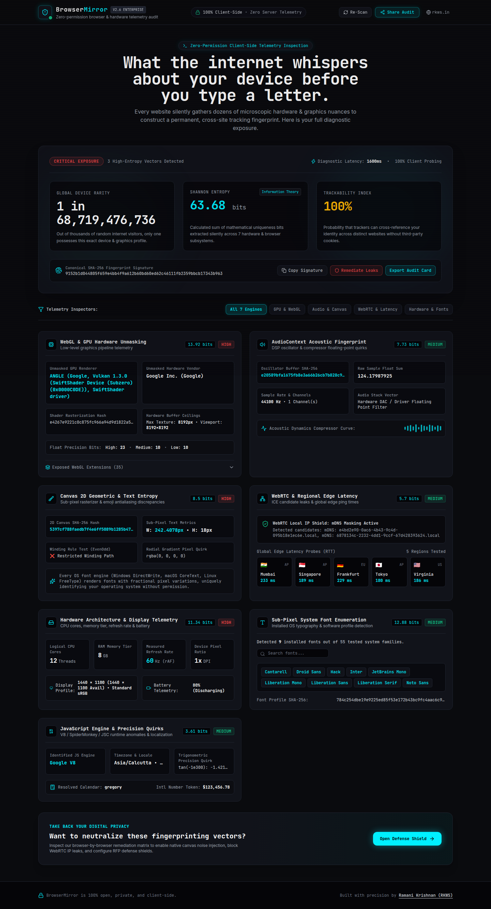
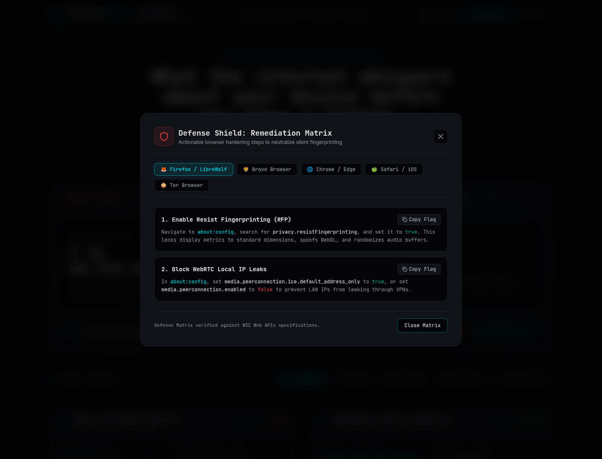
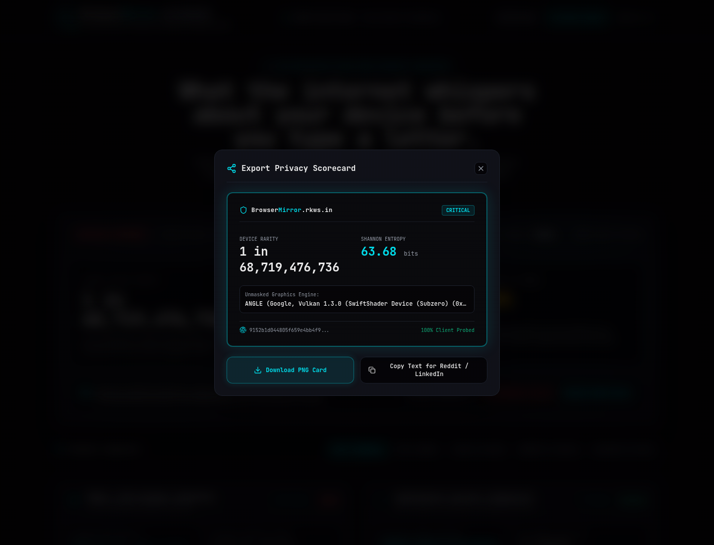

# 🛡️ BrowserMirror (`mirror.rkws.in`)

> *"What the internet whispers about your device before you type a letter."*

[](https://mirror.rkws.in)
[](LICENSE)
[](https://mirror.rkws.in)

**BrowserMirror** is a zero-permission, ultra-fast client-side browser and hardware telemetry audit terminal. It reveals the invisible telemetry every modern browser exposes to advertising networks, fraud detection services, and fingerprinting trackers—packaged inside a high-aesthetic, cinematic security HUD.

---

## 📸 Terminal Preview



---

## ⚡ The 7 Deep Telemetry Inspection Engines

BrowserMirror requests **zero permissions** (no microphone, camera, or location popups). All detection leverages standard W3C Web APIs that trackers harvest invisibly:

| Vector | Web APIs & Methods | What It Exposes |
| :--- | :--- | :--- |
| **1. WebGL & GPU Unmasking** | `WEBGL_debug_renderer_info`, GLSL shader compiler, `gl.readPixels()` | Exact graphics card (`NVIDIA RTX 4070`, `Apple M2 GPU`), sub-pixel trigonometric rasterizer quirks, 35+ extensions. |
| **2. AudioContext Acoustic Signature** | `OfflineAudioContext`, `OscillatorNode` (10 kHz), `DynamicsCompressorNode` | OS audio stack DAC discrepancies (macOS CoreAudio, Windows WASAPI, Linux ALSA) hashed via SHA-256. |
| **3. 2D Canvas Geometric Entropy** | `<canvas>` 2D context, bezier curves, multi-script Unicode, emoji ZWJ sequences | Sub-pixel antialiasing differences across OS font rasterizers (*DirectWrite*, *CoreText*, *FreeType*). |
| **4. WebRTC Network & Edge Latency** | `RTCPeerConnection`, STUN ICE candidate discovery, regional edge ping probes | Local LAN IPv4/IPv6 leaks bypassing VPNs, mDNS masking status, and RTT latency across 5 global regions. |
| **5. Hardware Architecture** | `navigator.hardwareConcurrency`, `deviceMemory`, 120-frame `requestAnimationFrame` loop | Exact logical CPU threads, RAM tier, 60Hz/120Hz/144Hz display refresh rate, and Battery API. |
| **6. Sub-Pixel Font Enumeration** | Fallback monospace/sans-serif span metric dimension probing | 55+ common and rare host system fonts without direct filesystem access. |
| **7. JavaScript Runtime Quirks** | `Error.captureStackTrace`, `Math.tan(-1e300)`, `Intl.DateTimeFormat` | Accurate JS engine identification (Google V8, Mozilla SpiderMonkey, Apple JavaScriptCore) and timezone. |

---

## 🧮 Mathematical Shannon Entropy & Rarity Engine

Instead of arbitrary percentages, BrowserMirror applies information theory:

$$H(X) = -\sum P(x_i) \log_2 P(x_i)$$

Total device uniqueness bits are aggregated across all 7 subsystems:
$$H_{\text{total}} = H(\text{WebGL}) + H(\text{Audio}) + H(\text{Canvas}) + H(\text{WebRTC}) + H(\text{Hardware}) + H(\text{Fonts}) + H(\text{Quirks})$$

Converted to global probabilistic rarity:
$$U = 100 \times (1 - 2^{-H_{\text{total}}})$$

---

## 🛡️ Actionable Defense Shield

Every detected leak links to actionable, browser-specific configuration guides:



* **Firefox / LibreWolf**: `about:config` flags (`privacy.resistFingerprinting`, `media.peerconnection.ice.default_address_only`).
* **Brave Browser**: Strict shields configuration for randomized canvas & audio noise injection.
* **Chrome / Chromium**: WebRTC network limiters and extension countermeasures.
* **Safari / iOS**: Advanced Tracking and Fingerprinting Protection settings.
* **Tor Browser**: Uniform baseline comparison.

---

## 📤 1-Click Shareable Audit Card



Generates a downloadable high-resolution PNG scorecard with your global device rarity and entropy bits, plus formatted copy text for LinkedIn and Reddit (`r/privacy`, `r/technology`, `r/developersIndia`).

---

## 🛠️ Local Development & Build

```bash
# Clone the repository
git clone https://github.com/Ramani-21-05/browser-mirror.git
cd browser-mirror

# Install dependencies
npm install

# Start Vite HMR development server
npm run dev

# Run full production build
npm run build

# Preview production build locally
npm run preview
```

---

## 📜 Author & Architecture

* **Lead Architect:** [Ramani Krishnan](https://github.com/Ramani-21-05)  
* **Parent Hub:** [rkws.in](https://rkws.in)  
* **Subdomain:** `mirror.rkws.in`  
* **License:** MIT
